# Op and layer sensitivity: Qwen2.5-0.5B-Instruct-Q4_K_M

7 prompts, 458 scored positions (every position of every prompt). Reference: plain F32 CPU build, perplexity 5.874 on the prompts. All LNS runs are LNSCUDA16 (bit-identical to LNS16 on the CPU). Metrics against the reference, averaged over positions: KL(ref || run) in nats, top-1 agreement, relative L2 error of the logits, and perplexity of the prompt text under the run.

## 1. Every op in LNS, per summation mode

| Mode | KL | top-1 agree | logit rel. error | perplexity |
|---|---|---|---|---|
| base | 0.4792 | 72.3% | 38% | 9.479 |
| monte | 0.3019 | 76.0% | 25% | 7.423 |
| lpvip | 4.9623 | 12.2% | 87% | 856.954 |
| sum32 | 0.1675 | 89.7% | 18% | 6.531 |

## Key configurations

| configuration | KL | top-1 agree | perplexity |
|---|---|---|---|
| all base | 0.4792 | 72.3% | 9.479 |
| all monte | 0.3019 | 76.0% | 7.423 |
| all sum32 | 0.1675 | 89.7% | 6.531 |
| base, rms_norm in sum32 | 0.2858 | 77.3% | 6.987 |
| base, rms_norm + residual in F32 | 0.1775 | 80.3% | 6.728 |
| monte, residual in F32 | 0.1709 | 75.5% | 6.951 |
| sum32, residual in F32 | 0.0105 | 93.4% | 5.847 |
| best greedy sum32 mix (rms_norm, ffn_down, lm_head, qkv_proj, kq) | 0.1482 | 87.6% | 6.417 |

## 2. Cost share of each op group

Share of the arithmetic of one forward pass over the first prompt (MUL_MAT: K multiply-adds per output; other ops: one per output element).

| Group | selector | share |
|---|---|---|
| qkv_proj | `MUL_MAT:Qcur-*,MUL_MAT:Kcur-*,MUL_MAT:Vcur-*` | 4.9% |
| qkv_bias | `ADD:Qcur-*,ADD:Kcur-*,ADD:Vcur-*` | 0.01% |
| rope | `ROPE` | 0.00% |
| kq | `MUL_MAT:kq-*` | 1.1% |
| softmax | `SOFT_MAX` | 0.02% |
| kqv | `MUL_MAT:kqv-*` | 1.1% |
| attn_out | `MUL_MAT:<kqv_out-*` | 3.8% |
| ffn_gate_up | `MUL_MAT:ffn_gate-*,MUL_MAT:ffn_up-*` | 41% |
| swiglu | `GLU` | 0.02% |
| ffn_down | `MUL_MAT:ffn_out-*` | 21% |
| rms_norm | `RMS_NORM` | 0.01% |
| norm_scale | `MUL` | 0.01% |
| residual | `ADD:ffn_inp-*,ADD:l_out-*` | 0.01% |
| lm_head | `MUL_MAT:result_output` | 27% |
| gather | `GET_ROWS` | 0.00% |

## 3. Only one group in LNS (everything else F32)

Error that each group introduces on its own. `% of full` compares with the all-LNS KL of the same mode.

| Group | base KL | base % of full | monte KL | monte % of full | lpvip KL | lpvip % of full | sum32 KL | sum32 % of full |
|---|---|---|---|---|---|---|---|---|
| qkv_proj | 0.0241 | 5.0% | 0.0092 | 3.1% | 0.4094 | 8.2% | 0.0040 | 2.4% |
| qkv_bias | 0.0038 | 0.79% | 0.0038 | 1.2% | 0.0038 | 0.08% | 0.0038 | 2.3% |
| rope | 0.0037 | 0.78% | 0.0037 | 1.2% | 0.0037 | 0.08% | 0.0037 | 2.2% |
| kq | 0.0145 | 3.0% | 0.0158 | 5.2% | 0.0099 | 0.20% | 0.0048 | 2.8% |
| softmax | 0.0044 | 0.91% | 0.0042 | 1.4% | 0.0045 | 0.09% | 0.0044 | 2.6% |
| kqv | 0.0031 | 0.65% | 0.0031 | 1.0% | 0.0036 | 0.07% | 0.0033 | 2.0% |
| attn_out | 0.0042 | 0.88% | 0.0049 | 1.6% | 0.1212 | 2.4% | 0.0035 | 2.1% |
| ffn_gate_up | 0.0573 | 12% | 0.0364 | 12% | 0.5781 | 12% | 0.0041 | 2.5% |
| swiglu | 0.0035 | 0.72% | 0.0035 | 1.1% | 0.0035 | 0.07% | 0.0035 | 2.1% |
| ffn_down | 0.0365 | 7.6% | 0.0329 | 11% | 4.1136 | 83% | 0.0037 | 2.2% |
| rms_norm | 0.1111 | 23% | 0.0111 | 3.7% | 0.0043 | 0.09% | 0.0037 | 2.2% |
| norm_scale | 0.0050 | 1.0% | 0.0050 | 1.6% | 0.0050 | 0.10% | 0.0050 | 3.0% |
| residual | 0.1743 | 36% | 0.1743 | 58% | 0.1743 | 3.5% | 0.1743 | 104% |
| lm_head | 0.0522 | 11% | 0.0810 | 27% | 0.0352 | 0.71% | 0.0007 | 0.41% |
| gather | 0.0000 | 0.00% | 0.0000 | 0.00% | 0.0000 | 0.00% | 0.0000 | 0.00% |
| **sum of isolated** | 0.4976 | 104% | 0.3888 | 129% | 5.4701 | 110% | 0.2223 | 133% |

## 4. Every group in LNS except one (that one in F32)

How much of the all-LNS error goes away when one group is kept in F32. `removed` is the drop in KL as a share of the all-LNS KL.

| Group | base KL | base removed | monte KL | monte removed | lpvip KL | lpvip removed | sum32 KL | sum32 removed |
|---|---|---|---|---|---|---|---|---|
| qkv_proj | 0.3793 | 21% | 0.3267 | -8% | 5.7349 | -16% | 0.1665 | 0.61% |
| qkv_bias | 0.4096 | 15% | 0.3038 | -1% | 4.9968 | -1% | 0.1662 | 0.79% |
| rope | 0.4277 | 11% | 0.3146 | -4% | 4.9335 | 0.58% | 0.1673 | 0.13% |
| kq | 0.4262 | 11% | 0.3025 | -0% | 4.9418 | 0.41% | 0.1675 | 0.02% |
| softmax | 0.3965 | 17% | 0.3223 | -7% | 4.9586 | 0.07% | 0.1670 | 0.30% |
| kqv | 0.4244 | 11% | 0.3218 | -7% | 4.9839 | -0% | 0.1661 | 0.86% |
| attn_out | 0.5072 | -6% | 0.3125 | -4% | 5.7733 | -16% | 0.1662 | 0.81% |
| ffn_gate_up | 0.4401 | 8.2% | 0.3179 | -5% | 3.6890 | 26% | 0.1698 | -1% |
| swiglu | 0.4203 | 12% | 0.3136 | -4% | 4.9405 | 0.44% | 0.1699 | -1% |
| ffn_down | 0.3675 | 23% | 0.2868 | 5.0% | 0.8531 | 83% | 0.1705 | -2% |
| rms_norm | 0.2824 | 41% | 0.2999 | 0.66% | 4.9783 | -0% | 0.1652 | 1.4% |
| norm_scale | 0.4441 | 7.3% | 0.3100 | -3% | 4.9878 | -1% | 0.1729 | -3% |
| residual | 0.2984 | 38% | 0.1709 | 43% | 4.9049 | 1.2% | 0.0105 | 94% |
| lm_head | 0.4267 | 11% | 0.2598 | 14% | 5.2207 | -5% | 0.1679 | -0% |
| gather | 0.4792 | 0.00% | 0.3019 | 0.00% | 4.9623 | 0.00% | 0.1675 | 0.00% |

## 5. Per layer

`only L`: every op of layer L in LNS, the rest F32. `all but L`: every op in LNS except layer L. KL per mode.

| Layer | base only L | base all but L | monte only L | monte all but L | lpvip only L | lpvip all but L | sum32 only L | sum32 all but L |
|---|---|---|---|---|---|---|---|---|
| 0 | 0.0127 | 0.4234 | 0.0121 | 0.2954 | 1.2724 | 3.5940 | 0.0043 | 0.1661 |
| 1 | 0.0128 | 0.4118 | 0.0069 | 0.2977 | 0.1699 | 5.2993 | 0.0037 | 0.1665 |
| 2 | 0.0132 | 0.4513 | 0.0074 | 0.2988 | 0.2003 | 5.4621 | 0.0035 | 0.1672 |
| 3 | 0.2150 | 0.3875 | 0.0328 | 0.3002 | 0.1855 | 5.6368 | 0.0142 | 0.1606 |
| 4 | 0.0170 | 0.4055 | 0.0068 | 0.2994 | 0.1186 | 6.9705 | 0.0049 | 0.1643 |
| 5 | 0.0166 | 0.4353 | 0.0074 | 0.3118 | 0.1520 | 4.8434 | 0.0045 | 0.1638 |
| 6 | 0.0163 | 0.6118 | 0.0067 | 0.2935 | 0.1460 | 5.2317 | 0.0043 | 0.1636 |
| 7 | 0.0133 | 0.4228 | 0.0062 | 0.2924 | 0.1292 | 4.9429 | 0.0040 | 0.1624 |
| 8 | 0.0121 | 0.4661 | 0.0061 | 0.3065 | 0.0995 | 5.0181 | 0.0038 | 0.1626 |
| 9 | 0.0116 | 0.4056 | 0.0047 | 0.2989 | 0.0668 | 5.3078 | 0.0032 | 0.1627 |
| 10 | 0.0109 | 0.4701 | 0.0050 | 0.2976 | 0.0835 | 5.1018 | 0.0036 | 0.1630 |
| 11 | 0.0110 | 0.4323 | 0.0043 | 0.2973 | 0.0629 | 5.7175 | 0.0030 | 0.1633 |
| 12 | 0.0100 | 0.4197 | 0.0043 | 0.3060 | 0.0579 | 5.4377 | 0.0031 | 0.1635 |
| 13 | 0.0090 | 0.4235 | 0.0043 | 0.3012 | 0.0619 | 5.3168 | 0.0032 | 0.1644 |
| 14 | 0.0114 | 0.4492 | 0.0053 | 0.3032 | 0.0958 | 4.8692 | 0.0033 | 0.1644 |
| 15 | 0.0102 | 0.4497 | 0.0049 | 0.3072 | 0.0985 | 5.2628 | 0.0036 | 0.1640 |
| 16 | 0.0096 | 0.4514 | 0.0049 | 0.3035 | 0.0973 | 4.7927 | 0.0031 | 0.1645 |
| 17 | 0.0090 | 0.4452 | 0.0044 | 0.3135 | 0.0827 | 4.8602 | 0.0032 | 0.1647 |
| 18 | 0.0085 | 0.4600 | 0.0042 | 0.3131 | 0.0913 | 4.7360 | 0.0030 | 0.1650 |
| 19 | 0.0079 | 0.4523 | 0.0041 | 0.3068 | 0.1228 | 5.0064 | 0.0024 | 0.1658 |
| 20 | 0.0090 | 0.4430 | 0.0051 | 0.3033 | 0.1386 | 4.8189 | 0.0039 | 0.1646 |
| 21 | 0.1131 | 0.5162 | 0.0278 | 0.3072 | 0.1277 | 4.8521 | 0.0129 | 0.1733 |
| 22 | 0.0075 | 0.4769 | 0.0041 | 0.3028 | 0.1326 | 5.2433 | 0.0015 | 0.1676 |
| 23 | 0.0570 | 0.4470 | 0.0121 | 0.2936 | 0.4920 | 4.7014 | 0.0021 | 0.1694 |

## 6. Mixed summation: one group's reductions in sum32, the rest base

All-base KL 0.4792, all-sum32 KL 0.1675. `gap closed` is the share of the base to sum32 KL gap this one upgrade closes.

| Group | share | KL | top-1 | perplexity | gap closed |
|---|---|---|---|---|---|
| qkv_proj | 4.9% | 0.3925 | 72.1% | 8.273 | 28% |
| kq | 1.1% | 0.3999 | 70.7% | 8.476 | 25% |
| softmax | 0.02% | 0.5006 | 71.0% | 9.375 | -7% |
| kqv | 1.1% | 0.4730 | 70.5% | 9.694 | 2.0% |
| attn_out | 3.8% | 0.4354 | 70.7% | 9.036 | 14% |
| ffn_gate_up | 41% | 0.4551 | 70.1% | 9.002 | 7.7% |
| ffn_down | 21% | 0.3776 | 74.0% | 7.995 | 33% |
| rms_norm | 0.01% | 0.2858 | 77.3% | 6.987 | 62% |
| lm_head | 27% | 0.4259 | 74.7% | 8.874 | 17% |

## 7. Greedy mixed policy: base everywhere, groups moved to sum32 one at a time

At each step the group whose change lowers KL the most is added. `share` is the cumulative share of the arithmetic that is no longer plain xlns16 base.

| Step | added | share | KL | top-1 | perplexity |
|---|---|---|---|---|---|
| 0 | (all base) | 0% | 0.4792 | 72.3% | 9.479 |
| 1 | rms_norm | 0.01% | 0.2858 | 77.3% | 6.987 |
| 2 | ffn_down | 21% | 0.2337 | 81.0% | 6.693 |
| 3 | lm_head | 48% | 0.1854 | 85.4% | 6.455 |
| 4 | qkv_proj | 53% | 0.1610 | 89.3% | 6.370 |
| 5 | kq | 54% | 0.1482 | 87.6% | 6.417 |
| 6 | softmax | 54% | 0.1489 | 86.7% | 6.449 |
| 7 | kqv | 55% | 0.1483 | 88.6% | 6.418 |
| 8 | attn_out | 59% | 0.1524 | 87.8% | 6.414 |
| 9 | ffn_gate_up | 100% | 0.1675 | 89.7% | 6.531 |

## 8. Greedy protection: base everywhere, groups moved to F32 one at a time

At each step the group whose change lowers KL the most is added. `share` is the cumulative share of the arithmetic that is no longer plain xlns16 base.

| Step | added | share | KL | top-1 | perplexity |
|---|---|---|---|---|---|
| 0 | (all base) | 0% | 0.4792 | 72.3% | 9.479 |
| 1 | rms_norm | 0.01% | 0.2824 | 75.8% | 7.159 |
| 2 | residual | 0.02% | 0.1775 | 80.3% | 6.728 |
| 3 | ffn_gate_up | 41% | 0.1148 | 83.4% | 6.330 |
| 4 | lm_head | 68% | 0.0711 | 84.9% | 6.094 |
| 5 | ffn_down | 89% | 0.0427 | 90.6% | 5.922 |
| 6 | qkv_proj | 94% | 0.0144 | 92.6% | 5.847 |
| 7 | kq | 95% | 0.0075 | 93.7% | 5.882 |
| 8 | norm_scale | 95% | 0.0061 | 94.1% | 5.908 |
| 9 | softmax | 95% | 0.0053 | 95.6% | 5.867 |
| 10 | attn_out | 99% | 0.0042 | 95.2% | 5.896 |
| 11 | rope | 99% | 0.0039 | 95.9% | 5.875 |
| 12 | qkv_bias | 99% | 0.0038 | 95.4% | 5.886 |
| 13 | swiglu | 99% | 0.0031 | 95.0% | 5.881 |
| 14 | kqv | 100% | 0.0000 | 100.0% | 5.874 |
| 15 | gather | 100% | 0.0000 | 100.0% | 5.874 |

## 9. Both greedy policies

