# Op sensitivity: both models

Cross-model view of the per-model reports ([Qwen2.5-0.5B](Qwen2.5-0.5B-Instruct-Q4_K_M/REPORT.md), [SmolLM2-135M](SmolLM2-135M-Instruct-Q4_K_M/REPORT.md)).

## Where the base-mode error comes from

| group | Qwen2.5-0.5B KL alone | Qwen2.5-0.5B % of all-base | Qwen2.5-0.5B arithmetic share | SmolLM2-135M KL alone | SmolLM2-135M % of all-base | SmolLM2-135M arithmetic share |
|---|---|---|---|---|---|---|
| qkv_proj | 0.0241 | 5.0% | 4.9% | 0.0112 | 4.4% | 12% |
| qkv_bias | 0.0038 | 0.79% | 0.01% | - | - | - |
| rope | 0.0037 | 0.78% | 0.00% | 0.0045 | 1.8% | 0.02% |
| kq | 0.0145 | 3.0% | 1.1% | 0.0060 | 2.4% | 3.1% |
| softmax | 0.0044 | 0.91% | 0.02% | 0.0049 | 1.9% | 0.05% |
| kqv | 0.0031 | 0.65% | 1.1% | 0.0048 | 1.9% | 3.1% |
| attn_out | 0.0042 | 0.88% | 3.8% | 0.0058 | 2.3% | 6.9% |
| ffn_gate_up | 0.0573 | 12% | 41% | 0.0118 | 4.7% | 37% |
| swiglu | 0.0035 | 0.72% | 0.02% | 0.0051 | 2.0% | 0.03% |
| ffn_down | 0.0365 | 7.6% | 21% | 0.0141 | 5.6% | 18% |
| rms_norm | 0.1111 | 23% | 0.01% | 0.0627 | 25% | 0.02% |
| norm_scale | 0.0050 | 1.0% | 0.01% | 0.0050 | 2.0% | 0.02% |
| residual | 0.1743 | 36% | 0.01% | 0.0579 | 23% | 0.02% |
| lm_head | 0.0522 | 11% | 27% | 0.0587 | 23% | 20% |

## Key configurations

| configuration | Qwen2.5-0.5B KL | Qwen2.5-0.5B perplexity (F32 5.874) | SmolLM2-135M KL | SmolLM2-135M perplexity (F32 8.474) |
|---|---|---|---|---|
| all base | 0.4792 | 9.479 | 0.2539 | 10.890 |
| all monte | 0.3019 | 7.423 | 0.1943 | 10.018 |
| all sum32 | 0.1675 | 6.531 | 0.0542 | 8.782 |
| base, rms_norm in sum32 | 0.2858 | 6.987 | 0.1418 | 9.464 |
| base, rms_norm + residual in F32 | 0.1775 | 6.728 | 0.0935 | 9.300 |
| monte, residual in F32 | 0.1709 | 6.951 | 0.1458 | 9.255 |
| sum32, residual in F32 | 0.0105 | 5.847 | 0.0069 | 8.418 |
| best greedy sum32 mix | 0.1482 | 6.417 | 0.0533 | 8.767 |

