# Op and layer sensitivity: SmolLM2-135M-Instruct-Q4_K_M

7 prompts, 447 scored positions (every position of every prompt). Reference: plain F32 CPU build, perplexity 8.474 on the prompts. All LNS runs are LNSCUDA16 (bit-identical to LNS16 on the CPU). Metrics against the reference, averaged over positions: KL(ref || run) in nats, top-1 agreement, relative L2 error of the logits, and perplexity of the prompt text under the run.

## 1. Every op in LNS, per summation mode

| Mode | KL | top-1 agree | logit rel. error | perplexity |
|---|---|---|---|---|
| base | 0.2539 | 73.2% | 30% | 10.890 |
| monte | 0.1943 | 76.3% | 22% | 10.018 |
| lpvip | 1.6380 | 40.7% | 98% | 33.829 |
| sum32 | 0.0542 | 87.7% | 17% | 8.782 |

## 2. Cost share of each op group

Share of the arithmetic of one forward pass over the first prompt (MUL_MAT: K multiply-adds per output; other ops: one per output element).

| Group | selector | share |
|---|---|---|
| qkv_proj | `MUL_MAT:Qcur-*,MUL_MAT:Kcur-*,MUL_MAT:Vcur-*` | 12% |
| rope | `ROPE` | 0.02% |
| kq | `MUL_MAT:kq-*` | 3.1% |
| softmax | `SOFT_MAX` | 0.05% |
| kqv | `MUL_MAT:kqv-*` | 3.1% |
| attn_out | `MUL_MAT:<kqv_out-*` | 6.9% |
| ffn_gate_up | `MUL_MAT:ffn_gate-*,MUL_MAT:ffn_up-*` | 37% |
| swiglu | `GLU` | 0.03% |
| ffn_down | `MUL_MAT:ffn_out-*` | 18% |
| rms_norm | `RMS_NORM` | 0.02% |
| norm_scale | `MUL` | 0.02% |
| residual | `ADD:ffn_inp-*,ADD:l_out-*` | 0.02% |
| lm_head | `MUL_MAT:result_output` | 20% |
| gather | `GET_ROWS` | 0.00% |

## 3. Only one group in LNS (everything else F32)

Error that each group introduces on its own. `% of full` compares with the all-LNS KL of the same mode.

| Group | base KL | base % of full | monte KL | monte % of full | lpvip KL | lpvip % of full | sum32 KL | sum32 % of full |
|---|---|---|---|---|---|---|---|---|
| qkv_proj | 0.0112 | 4.4% | 0.0142 | 7.3% | 0.3801 | 23% | 0.0055 | 10% |
| rope | 0.0045 | 1.8% | 0.0045 | 2.3% | 0.0045 | 0.27% | 0.0045 | 8.2% |
| kq | 0.0060 | 2.4% | 0.0057 | 2.9% | 0.0088 | 0.54% | 0.0045 | 8.4% |
| softmax | 0.0049 | 1.9% | 0.0046 | 2.4% | 0.0047 | 0.29% | 0.0048 | 8.8% |
| kqv | 0.0048 | 1.9% | 0.0050 | 2.6% | 0.0049 | 0.30% | 0.0049 | 9.0% |
| attn_out | 0.0058 | 2.3% | 0.0067 | 3.5% | 0.0817 | 5.0% | 0.0048 | 8.8% |
| ffn_gate_up | 0.0118 | 4.7% | 0.0152 | 7.8% | 0.5495 | 34% | 0.0048 | 8.8% |
| swiglu | 0.0051 | 2.0% | 0.0051 | 2.6% | 0.0051 | 0.31% | 0.0051 | 9.4% |
| ffn_down | 0.0141 | 5.6% | 0.0189 | 9.7% | 0.5413 | 33% | 0.0054 | 10% |
| rms_norm | 0.0627 | 25% | 0.0134 | 6.9% | 0.0056 | 0.34% | 0.0049 | 9.0% |
| norm_scale | 0.0050 | 2.0% | 0.0050 | 2.6% | 0.0050 | 0.31% | 0.0050 | 9.3% |
| residual | 0.0579 | 23% | 0.0579 | 30% | 0.0579 | 3.5% | 0.0579 | 107% |
| lm_head | 0.0587 | 23% | 0.0944 | 49% | 0.0563 | 3.4% | 0.0008 | 1.6% |
| gather | 0.0000 | 0.00% | 0.0000 | 0.00% | 0.0000 | 0.00% | 0.0000 | 0.00% |
| **sum of isolated** | 0.2525 | 99% | 0.2505 | 129% | 1.7056 | 104% | 0.1129 | 208% |

## 4. Every group in LNS except one (that one in F32)

How much of the all-LNS error goes away when one group is kept in F32. `removed` is the drop in KL as a share of the all-LNS KL.

| Group | base KL | base removed | monte KL | monte removed | lpvip KL | lpvip removed | sum32 KL | sum32 removed |
|---|---|---|---|---|---|---|---|---|
| qkv_proj | 0.2445 | 3.7% | 0.1743 | 10% | 1.4299 | 13% | 0.0508 | 6.2% |
| rope | 0.2486 | 2.1% | 0.1838 | 5.4% | 1.6217 | 0.99% | 0.0544 | -0% |
| kq | 0.2475 | 2.5% | 0.1844 | 5.1% | 1.6207 | 1.1% | 0.0541 | 0.09% |
| softmax | 0.2573 | -1% | 0.1867 | 3.9% | 1.6362 | 0.11% | 0.0536 | 1.0% |
| kqv | 0.2548 | -0% | 0.1927 | 0.82% | 1.6307 | 0.45% | 0.0535 | 1.3% |
| attn_out | 0.2391 | 5.8% | 0.1810 | 6.9% | 1.7052 | -4% | 0.0529 | 2.5% |
| ffn_gate_up | 0.2574 | -1% | 0.1944 | -0% | 1.0683 | 35% | 0.0556 | -3% |
| swiglu | 0.2696 | -6% | 0.1847 | 4.9% | 1.6176 | 1.2% | 0.0572 | -6% |
| ffn_down | 0.2365 | 6.8% | 0.1706 | 12% | 0.6712 | 59% | 0.0562 | -4% |
| rms_norm | 0.1420 | 44% | 0.1748 | 10% | 1.6541 | -1% | 0.0570 | -5% |
| norm_scale | 0.2556 | -1% | 0.1896 | 2.4% | 1.6348 | 0.19% | 0.0543 | -0% |
| residual | 0.1492 | 41% | 0.1458 | 25% | 1.7555 | -7% | 0.0069 | 87% |
| lm_head | 0.1892 | 25% | 0.0863 | 56% | 1.7090 | -4% | 0.0544 | -0% |
| gather | 0.2539 | 0.00% | 0.1943 | 0.00% | 1.6380 | 0.00% | 0.0542 | 0.00% |

## 5. Per layer

`only L`: every op of layer L in LNS, the rest F32. `all but L`: every op in LNS except layer L. KL per mode.

| Layer | base only L | base all but L | monte only L | monte all but L | lpvip only L | lpvip all but L | sum32 only L | sum32 all but L |
|---|---|---|---|---|---|---|---|---|
| 0 | 0.0127 | 0.2652 | 0.0079 | 0.1804 | 0.2132 | 1.3419 | 0.0054 | 0.0535 |
| 1 | 0.0078 | 0.2610 | 0.0074 | 0.1849 | 0.1210 | 1.6886 | 0.0058 | 0.0475 |
| 2 | 0.0083 | 0.2429 | 0.0076 | 0.1750 | 0.0728 | 1.6426 | 0.0058 | 0.0474 |
| 3 | 0.0070 | 0.2360 | 0.0051 | 0.1781 | 0.0544 | 1.6317 | 0.0049 | 0.0494 |
| 4 | 0.0070 | 0.2565 | 0.0055 | 0.1720 | 0.0463 | 1.7198 | 0.0048 | 0.0497 |
| 5 | 0.0061 | 0.2461 | 0.0050 | 0.1760 | 0.0429 | 1.6290 | 0.0047 | 0.0483 |
| 6 | 0.0065 | 0.2518 | 0.0049 | 0.1810 | 0.0469 | 1.5937 | 0.0044 | 0.0498 |
| 7 | 0.0057 | 0.2438 | 0.0050 | 0.1814 | 0.0357 | 1.6786 | 0.0040 | 0.0495 |
| 8 | 0.0065 | 0.2490 | 0.0052 | 0.1810 | 0.0490 | 1.6196 | 0.0045 | 0.0486 |
| 9 | 0.0078 | 0.2326 | 0.0055 | 0.1856 | 0.0401 | 1.5814 | 0.0046 | 0.0503 |
| 10 | 0.0061 | 0.2452 | 0.0052 | 0.1797 | 0.0449 | 1.6317 | 0.0040 | 0.0496 |
| 11 | 0.0061 | 0.2649 | 0.0054 | 0.1748 | 0.0524 | 1.5790 | 0.0045 | 0.0472 |
| 12 | 0.0055 | 0.2463 | 0.0047 | 0.1879 | 0.0375 | 1.6897 | 0.0037 | 0.0500 |
| 13 | 0.0057 | 0.2444 | 0.0046 | 0.1784 | 0.0396 | 1.6878 | 0.0036 | 0.0506 |
| 14 | 0.0053 | 0.2580 | 0.0045 | 0.1751 | 0.0386 | 1.7265 | 0.0038 | 0.0501 |
| 15 | 0.0053 | 0.2469 | 0.0045 | 0.1740 | 0.0361 | 1.7782 | 0.0034 | 0.0486 |
| 16 | 0.0053 | 0.2434 | 0.0044 | 0.1778 | 0.0355 | 1.7101 | 0.0033 | 0.0499 |
| 17 | 0.0049 | 0.2456 | 0.0044 | 0.1869 | 0.0368 | 1.6772 | 0.0033 | 0.0508 |
| 18 | 0.0054 | 0.2543 | 0.0042 | 0.1893 | 0.0381 | 1.6461 | 0.0032 | 0.0511 |
| 19 | 0.0052 | 0.2405 | 0.0046 | 0.1945 | 0.0440 | 1.6548 | 0.0033 | 0.0514 |
| 20 | 0.0051 | 0.2471 | 0.0041 | 0.1963 | 0.0479 | 1.5915 | 0.0031 | 0.0512 |
| 21 | 0.0058 | 0.2455 | 0.0045 | 0.1886 | 0.0428 | 1.6407 | 0.0029 | 0.0513 |
| 22 | 0.0056 | 0.2473 | 0.0045 | 0.1855 | 0.0586 | 1.5110 | 0.0026 | 0.0526 |
| 23 | 0.0048 | 0.2419 | 0.0045 | 0.1827 | 0.0617 | 1.5029 | 0.0027 | 0.0527 |
| 24 | 0.0062 | 0.2402 | 0.0039 | 0.1859 | 0.0473 | 1.5984 | 0.0028 | 0.0508 |
| 25 | 0.0067 | 0.2491 | 0.0036 | 0.1846 | 0.0532 | 1.5638 | 0.0024 | 0.0509 |
| 26 | 0.0078 | 0.2361 | 0.0037 | 0.1806 | 0.0656 | 1.5328 | 0.0021 | 0.0519 |
| 27 | 0.0082 | 0.2386 | 0.0039 | 0.1874 | 0.0592 | 1.5594 | 0.0022 | 0.0519 |
| 28 | 0.0167 | 0.2578 | 0.0062 | 0.1827 | 0.0718 | 1.6653 | 0.0031 | 0.0521 |
| 29 | 0.0686 | 0.2010 | 0.0140 | 0.1954 | 0.2860 | 1.7746 | 0.0039 | 0.0620 |

## 6. Mixed summation: one group's reductions in sum32, the rest base

All-base KL 0.2539, all-sum32 KL 0.0542. `gap closed` is the share of the base to sum32 KL gap this one upgrade closes.

| Group | share | KL | top-1 | perplexity | gap closed |
|---|---|---|---|---|---|
| qkv_proj | 12% | 0.2405 | 73.2% | 10.813 | 6.7% |
| kq | 3.1% | 0.2531 | 74.0% | 11.064 | 0.37% |
| softmax | 0.05% | 0.2575 | 74.0% | 11.190 | -2% |
| kqv | 3.1% | 0.2482 | 73.8% | 10.867 | 2.9% |
| attn_out | 6.9% | 0.2446 | 73.2% | 10.940 | 4.7% |
| ffn_gate_up | 37% | 0.2432 | 72.5% | 11.196 | 5.4% |
| ffn_down | 18% | 0.2402 | 72.0% | 10.731 | 6.8% |
| rms_norm | 0.02% | 0.1418 | 80.8% | 9.464 | 56% |
| lm_head | 20% | 0.1886 | 77.2% | 10.580 | 33% |

## 7. Greedy mixed policy: base everywhere, groups moved to sum32 one at a time

At each step the group whose change lowers KL the most is added. `share` is the cumulative share of the arithmetic that is no longer plain xlns16 base.

| Step | added | share | KL | top-1 | perplexity |
|---|---|---|---|---|---|
| 0 | (all base) | 0% | 0.2539 | 73.2% | 10.890 |
| 1 | rms_norm | 0.02% | 0.1418 | 80.8% | 9.464 |
| 2 | lm_head | 20% | 0.0774 | 84.8% | 8.970 |
| 3 | ffn_gate_up | 57% | 0.0669 | 86.6% | 8.946 |
| 4 | ffn_down | 75% | 0.0602 | 87.2% | 8.911 |
| 5 | qkv_proj | 87% | 0.0566 | 87.7% | 8.772 |
| 6 | attn_out | 94% | 0.0541 | 88.1% | 8.752 |
| 7 | kqv | 97% | 0.0538 | 87.7% | 8.701 |
| 8 | kq | 100% | 0.0533 | 87.5% | 8.767 |
| 9 | softmax | 100% | 0.0542 | 87.7% | 8.782 |

## 8. Greedy protection: base everywhere, groups moved to F32 one at a time

At each step the group whose change lowers KL the most is added. `share` is the cumulative share of the arithmetic that is no longer plain xlns16 base.

| Step | added | share | KL | top-1 | perplexity |
|---|---|---|---|---|---|
| 0 | (all base) | 0% | 0.2539 | 73.2% | 10.890 |
| 1 | rms_norm | 0.02% | 0.1420 | 78.5% | 9.438 |
| 2 | lm_head | 20% | 0.0778 | 86.1% | 9.102 |
| 3 | residual | 20% | 0.0300 | 91.5% | 8.647 |
| 4 | ffn_down | 38% | 0.0192 | 92.4% | 8.451 |
| 5 | ffn_gate_up | 75% | 0.0135 | 92.4% | 8.496 |
| 6 | qkv_proj | 87% | 0.0077 | 94.9% | 8.435 |
| 7 | attn_out | 94% | 0.0069 | 95.5% | 8.521 |
| 8 | kq | 97% | 0.0061 | 96.2% | 8.404 |
| 9 | norm_scale | 97% | 0.0054 | 96.0% | 8.453 |
| 10 | swiglu | 97% | 0.0051 | 95.7% | 8.433 |
| 11 | kqv | 100% | 0.0049 | 95.5% | 8.457 |
| 12 | softmax | 100% | 0.0045 | 96.0% | 8.406 |
| 13 | rope | 100% | 0.0000 | 100.0% | 8.474 |
| 14 | qkv_bias | 100% | 0.0000 | 100.0% | 8.474 |
| 15 | gather | 100% | 0.0000 | 100.0% | 8.474 |

## 9. Both greedy policies

